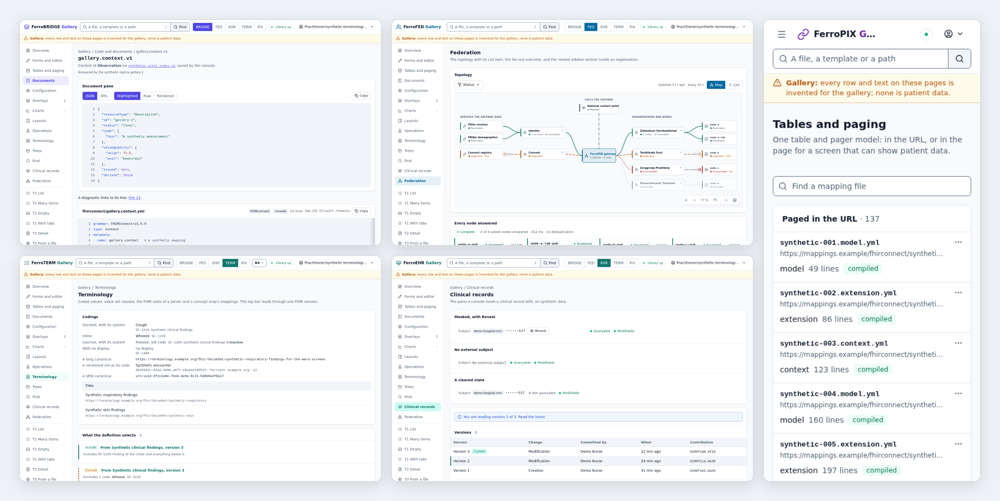

<!-- SPDX-FileCopyrightText: Cadasto B.V. -->
<!-- SPDX-License-Identifier: BUSL-1.1 -->
<div align="center">


**The component library every FerroHEALTH console is built from, in Rust.**

[Documentation](crates/ferrohealth-ui/README.md) ·
[What it provides](#what-it-provides) ·
[Install](#install) ·
[Licensing](https://ferrohealth.eu/docs/licensing.html)

**Project**<br>
[](https://github.com/FerroHEALTH/FerroUI/releases/latest)
[](https://github.com/FerroHEALTH/FerroUI/actions/workflows/ci.yml)
[](LICENSE)
[](https://crates.io/crates/ferrohealth-ui)
[](https://docs.rs/ferrohealth-ui)

**Quality and security**<br>
[](https://scorecard.dev/viewer/?uri=github.com/FerroHEALTH/FerroUI)
[](https://github.com/FerroHEALTH/FerroUI/actions/workflows/codeql.yml)
[](docs/release.md)
[](docs/release.md)

</div>

## What FerroUI does

The FerroHEALTH products each come with a web console, the screens an
administrator, a data steward or a terminology editor works in. FerroUI is
the one set of building blocks all those consoles are made from: page
layouts, tables, forms, menus, code viewers and clinical views, in five
brand colours, each in a light and a dark theme.

Because every console uses the same parts, they look and behave alike, and
a fix or an accessibility improvement reaches all of them at once. Every
colour pairing meets WCAG 2.2 AA (the web accessibility guidelines), and
every important action keeps a plain link or form behind it, so a page
still works when its scripts do not load.

### Who it is for

- **People who use the FerroHEALTH consoles**, who get the same layout,
  keyboard behaviour and themes in each product.
- **Developers of the FerroHEALTH consoles**, and of other server-rendered
  web applications in Rust, who build pages from reviewed components.

### Why you can trust what it claims

Every release is signed and carries SLSA build provenance, so you can check
that the crate you use is the one built here. The source is public, and
every component is in this repository: there is no paid edition with extra
parts. The contrast of every colour pairing is held by the crate's own test
and by a browser journey over the gallery, so an accessibility claim is
checked on every change.

## Part of FerroHEALTH

FerroHEALTH is five servers, each its own product, that reach each other
only over published standards: FerroEHR stores the record, FerroBRIDGE
translates it to FHIR and the OMOP research model, FerroFED connects records
across organisations and borders, FerroPIX matches patient identities, and
FerroTERM serves the code systems (the shared lists of medical terms). Work
that every server needs lives in three shared libraries: FerroAUTH for
sign-in and access control, FerroAUDIT for the audit trail, and FerroUI for
the web consoles. The consoles of FerroBRIDGE, FerroFED, FerroEHR, FerroTERM
and FerroPIX are all built from FerroUI.

<picture>
  <source media="(prefers-color-scheme: dark)" srcset="docs/hero-dark.png">
  
</picture>

## What it provides

One crate, [`ferrohealth-ui`](crates/ferrohealth-ui/README.md), with one
feature, `axum` (on by default), which adds the router that serves the
stylesheet, the themes and the script modules. The components:

- [Page templates](design/COMPONENTS.md#page-templates): list, detail, settings, About and the error page
- [The table](design/COMPONENTS.md#the-table): find, filter, sort and page by links and forms, with the state in the URL or the session
- [Forms and overlays](design/COMPONENTS.md#from-ferropix-r1-to-r29): tabs, form fields, the date picker, toasts, sign-in and the preferences page
- [Configuration views](design/COMPONENTS.md#from-ferrofed-f1-to-f14-for-every-console): revisions, the commit-confirm countdown, the secret field, the topology
- [Code and operations views](design/COMPONENTS.md#from-ferrobridge-b1-to-b11-for-every-console): the code viewer and editor, diagnostics, run reports, the HL7 v2 viewer
- [Terminology views](design/COMPONENTS.md#from-ferroterm-m1-to-m6-for-every-console): the concept tree, the coding, the version select, the value set clause
- [Clinical views](design/COMPONENTS.md#from-ferroehr-e1-to-e8-for-every-console): version history, the clinical reading, the folder tree, the query builder
- [Five brands, light and dark](crates/ferrohealth-ui/README.md#the-stylesheet-and-a-theme), with highlighters for YAML, JSON, XML and AQL and the Lucide icons
- [Locales](crates/ferrohealth-ui/README.md#locales), chosen by the configuration or negotiated over `Accept-Language`
- [The gallery](app/ferrohealth-ui-gallery), every component in every brand, with its [screenshots](docs/screenshots/)

## Install

The crate needs Rust 1.98 or newer (edition 2024). Pin the version exactly,
as every FerroHEALTH console does: a console moves its pin after looking at
its own screens.

```sh
cargo add ferrohealth-ui@=0.6.9
```

## Usage

Every component is a function that returns `html::Html`, which your own
Askama template writes with `{{ part }}`. A handler draws its page and
returns the whole document, and the console mounts the asset router once:

```rust
use ferrohealth_ui::html::Html;
use ferrohealth_ui::i18n::Locale;
use ferrohealth_ui::serve::{Assets, PREFIX, axum_router};
use ferrohealth_ui::style::Brand;
use ferrohealth_ui::theme::Preferences;
use ferrohealth_ui::view::shell::{Document, document};

let app: axum::Router = axum::Router::new()
    // .route("/templates", get(templates)) and the rest of your pages
    .nest(PREFIX, axum_router::router());

let page = document(Document {
    locale: Locale::default(),
    preferences: Preferences::default(),
    title: String::from("Templates · FerroBRIDGE"),
    assets: Assets::of(Brand::Bridge),
    nonce: None,
    head: Html::empty(),
    body: Html::text("the page"),
});
```

The [crate README](crates/ferrohealth-ui/README.md) is the integration
guide: the assets, the stylesheet and a theme, the components, the top bar,
the locales and the preferences. The [console guide](docs/consoles.md) says
what the library owns and what a console owns.

To see every component, run the gallery from a checkout:

```sh
git clone https://github.com/FerroHEALTH/FerroUI && cd FerroUI
cargo run -p ferrohealth-ui-gallery
```

Then open <http://127.0.0.1:3000>.

## Security and accessibility

- Every page is rendered on the server and complete without scripts: every
  important action is a link or a form, and the script modules only add
  behaviour on top.
- A console's policy is `script-src 'self'; style-src 'self'`; the document
  loads one script, the loader `fui.js`, and needs a nonce only when the
  console's own policy keeps one.
- Markup is escaped once: a component returns `Html`, which Askama writes
  without escaping it again.
- Every colour pairing of every theme meets WCAG 2.2 AA, held by the crate's
  tests and a browser journey over the gallery.
- The crate contains no `unsafe` code (`unsafe_code = "forbid"`), and
  `cargo-deny` checks every dependency on every pull request.
- Report a vulnerability privately as the [security policy](SECURITY.md)
  describes.

## Versioning

The crate follows [Cargo's SemVer rules](https://doc.rust-lang.org/cargo/reference/semver.html)
and is released by the signed tag `vX.Y.Z`, with the [changelog](CHANGELOG.md)
written from the fragments under `changelog.d/`. On the `0.x` line a release
that breaks a public API moves the minor version, and its changelog entry
names what a console changes; the
[0.6 migration guide](docs/migration-0.6.md) is the latest such guide. The
release process is in [`docs/release.md`](docs/release.md).

## Documentation

- The [crate README](crates/ferrohealth-ui/README.md) and the API reference
  on [docs.rs](https://docs.rs/ferrohealth-ui).
- The [component specs](design/COMPONENTS.md) and [the design](design/README.md),
  where a component change starts.
- The [console guide](docs/consoles.md) and the
  [rendering model](docs/rendering-model.md).
- The [FerroHEALTH book](https://ferrohealth.eu/docs/).

## Support

[SUPPORT.md](SUPPORT.md) says where to ask a question and how to report a
defect. Read [CONTRIBUTING.md](CONTRIBUTING.md) and the
[code of conduct](CODE_OF_CONDUCT.md) before you open a pull request;
[GOVERNANCE.md](GOVERNANCE.md) and [MAINTAINERS.md](MAINTAINERS.md) say who
decides and who reviews.

## Licence

Business Source License 1.1 ([LICENSE](LICENSE), [NOTICE](NOTICE)), with
Apache License 2.0 as the Change License four years after each version; the
vendored Lucide icons keep their ISC licence. Non-production use and
non-commercial production use are free; the
[licensing page](https://ferrohealth.eu/docs/licensing.html) says when you
need a commercial licence from Cadasto B.V.
