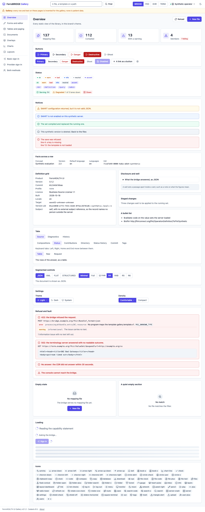

<!-- SPDX-FileCopyrightText: Cadasto B.V. -->
<!-- SPDX-License-Identifier: BUSL-1.1 -->

# FerroUI

The shared UI component library of the FerroHEALTH consoles: FerroBRIDGE,
FerroFED, FerroEHR and FerroTERM. It is published on crates.io as
[`ferrohealth-ui`](https://crates.io/crates/ferrohealth-ui), for Leptos 0.8.



## What is here

- `crates/ferrohealth-ui`: the library. Static view functions, a few
  interactive widgets, one table model, highlighters for YAML, JSON, XML and
  AQL, Lucide icons, and one plain-CSS stylesheet with a theme file per
  product. The [crate README](crates/ferrohealth-ui/README.md) is the
  integration guide.
- `app/ferrohealth-ui-gallery`: the gallery, which shows every component in
  every product theme, light and dark, with browser journeys and the
  screenshots under [`docs/screenshots/`](docs/screenshots/). It is never
  published.

## Use it

```toml
[dependencies]
ferrohealth-ui = "=0.1.2"
```

Serve `ferrohealth_ui::style::STYLESHEET` and your brand's `Brand::theme()`
as two stylesheets of your own origin, and write `data-theme` on `<html>`.
The crate README has the details.

## Accessibility

Every component targets WCAG 2.2 Level AA in the light and dark theme of
every brand. The crate's contrast test checks every role pairing, and a
gallery journey checks the colours the browser paints.

## Run the gallery

```
cd app/ferrohealth-ui-gallery
cargo leptos watch
```

Then open <http://127.0.0.1:3000>.

## Contributing

See [CONTRIBUTING.md](CONTRIBUTING.md), [SECURITY.md](SECURITY.md) and
[SUPPORT.md](SUPPORT.md).

## Licence

Business Source License 1.1, Licensor Cadasto B.V., converting to Apache 2.0
four years after each version. See [`LICENSE`](LICENSE) and
[`NOTICE`](NOTICE). The vendored Lucide icons keep their ISC licence.
