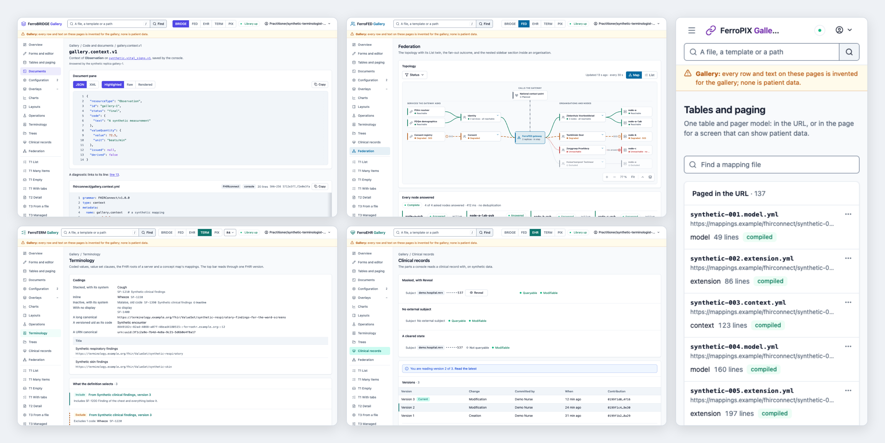

<!-- SPDX-FileCopyrightText: Cadasto B.V. -->
<!-- SPDX-License-Identifier: BUSL-1.1 -->
<div align="center">


**The component library every FerroHEALTH console is built from, in Rust.**

[Documentation](crates/ferrohealth-ui/README.md) ·
[Quick start](#quick-start) ·
[What ships today](#what-ships-today) ·
[Licensing](https://ferrohealth.eu/docs/licensing.html)

**Project**<br>
[](https://github.com/FerroHEALTH/FerroUI/releases/latest)
[](https://github.com/FerroHEALTH/FerroUI/actions/workflows/ci.yml)
[](LICENSE)
[](https://crates.io/crates/ferrohealth-ui)
[](https://docs.rs/ferrohealth-ui)

**Quality and security**<br>
[](https://scorecard.dev/viewer/?uri=github.com/FerroHEALTH/FerroUI)
[](https://github.com/FerroHEALTH/FerroUI/actions/workflows/codeql.yml)
[](docs/release.md)
[](docs/release.md)

</div>

## What FerroUI does

The FerroHEALTH products each come with a web console, the screens an
administrator, a data steward or a terminology editor works in. FerroUI is
the one set of building blocks all those consoles are made from: page
layouts, tables, forms, menus, code viewers and clinical views, in five
brand colours, each in a light and a dark theme.

Because every console uses the same parts, they look and behave alike, and
a fix or an accessibility improvement reaches all of them at once. Every
colour pairing meets WCAG 2.2 AA (the web accessibility guidelines), and
every important action keeps a plain link or form behind it, so a page
still works when its scripts do not load.

### Who it is for

- **People who use the FerroHEALTH consoles**, who get the same layout,
  keyboard behaviour and themes in each product.
- **Developers of the FerroHEALTH consoles**, and of other server-rendered
  web applications in Rust, who build pages from reviewed components.

### Why you can trust what it claims

Every release is signed and carries SLSA build provenance, so you can check
that the crate you use is the one built here. The source is public, and
every component is in this repository: there is no paid edition with extra
parts. The contrast of every colour pairing is held by the crate's own test
and by a browser journey over the gallery, so an accessibility claim is
checked on every change.

## Part of FerroHEALTH

FerroHEALTH is five servers, each its own product, that reach each other
only over published standards: FerroEHR stores the record, FerroBRIDGE
translates it to FHIR and the OMOP research model, FerroFED connects records
across organisations and borders, FerroPIX matches patient identities, and
FerroTERM serves the code systems (the shared lists of medical terms). Work
that every server needs lives in three shared libraries: FerroAUTH for
sign-in and access control, FerroAUDIT for the audit trail, and FerroUI for
the web consoles. The consoles of FerroBRIDGE, FerroFED, FerroEHR, FerroTERM
and FerroPIX are all built from FerroUI.

<picture>
  <source media="(prefers-color-scheme: dark)" srcset="docs/hero-dark.png">
  
</picture>

## Quick start

Add the crate to an axum application, pinned exactly:

```sh
cargo add ferrohealth-ui@=0.6.3
```

The [crate README](crates/ferrohealth-ui/README.md) is the integration
guide: the assets, the document, the stylesheet and theme, and the
locales. To see every component, run the gallery from a checkout:

```sh
git clone https://github.com/FerroHEALTH/FerroUI && cd FerroUI
cargo run -p ferrohealth-ui-gallery
```

Then open <http://127.0.0.1:3000>.

## What ships today

- [Page templates](design/COMPONENTS.md#page-templates): list, detail, settings, About and the error page
- [The table](design/COMPONENTS.md#the-table): find, filter, sort and page by links and forms, with the state in the URL or the session
- [Forms and overlays](design/COMPONENTS.md#from-ferropix-r1-to-r29): tabs, form fields, the date picker, toasts, sign-in and the preferences page
- [Configuration views](design/COMPONENTS.md#from-ferrofed-f1-to-f14-for-every-console): revisions, the commit-confirm countdown, the secret field, the topology
- [Code and operations views](design/COMPONENTS.md#from-ferrobridge-b1-to-b10-for-every-console): the code viewer and editor, diagnostics, run reports, the HL7 v2 viewer
- [Terminology views](design/COMPONENTS.md#from-ferroterm-m1-to-m6-for-every-console): the concept tree, the coding, the version select, the value set clause
- [Clinical views](design/COMPONENTS.md#from-ferroehr-e1-to-e8-for-every-console): version history, the clinical reading, the folder tree, the query builder
- [Five brands, light and dark](crates/ferrohealth-ui/README.md), with highlighters for YAML, JSON, XML and AQL and the Lucide icons
- [The gallery](app/ferrohealth-ui-gallery), every component in every brand, with its [screenshots](docs/screenshots/)

<details>
<summary><b>Published crates</b> (1)</summary>

| Crate | What it does | Version | Docs | Downloads |
|---|---|---|---|---|
| [`ferrohealth-ui`](https://crates.io/crates/ferrohealth-ui) | The shared UI components of the FerroHEALTH consoles: server-rendered Askama components, role tokens, plain script modules, a highlighter and one table model | [](https://crates.io/crates/ferrohealth-ui) | [](https://docs.rs/ferrohealth-ui) | [](https://crates.io/crates/ferrohealth-ui) |

</details>

## Learn more

- [The crate README](crates/ferrohealth-ui/README.md), [the component specs](design/COMPONENTS.md) and [what the library and a console each own](docs/consoles.md)
- [The design](design/README.md), where a component change starts
- [Changelog](CHANGELOG.md) and [milestones](https://github.com/FerroHEALTH/FerroUI/milestones)
- [Security policy](SECURITY.md) and the [FerroHEALTH book](https://ferrohealth.eu/docs/)
- [Contributing](CONTRIBUTING.md), [code of conduct](CODE_OF_CONDUCT.md), [support](SUPPORT.md), [governance](GOVERNANCE.md) and [maintainers](MAINTAINERS.md)

## Licence

Business Source License 1.1 ([LICENSE](LICENSE)), with Apache License 2.0 as
the Change License four years after each version; the vendored Lucide icons
keep their ISC licence. The
[licensing page](https://ferrohealth.eu/docs/licensing.html) says when you
need a commercial licence from Cadasto B.V.
